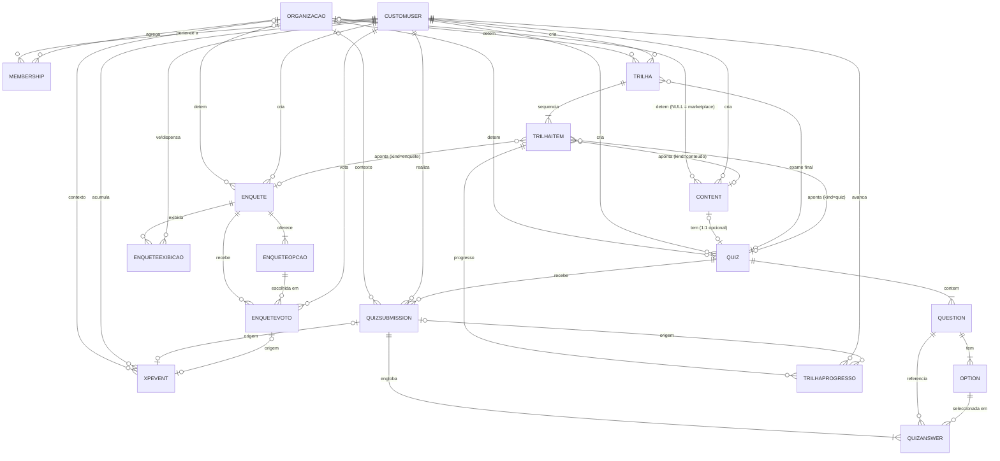
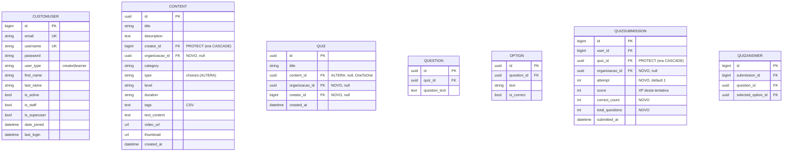

# KOMBINU — ERD e Dicionário de Dados (Fase 1, SLA §9.3)

| Campo | Valor |
|---|---|
| Documento | Entregável Fase 1 — Modelagem de dados documentada |
| Base | SLA v2.0.0 §9.3; `docs/relatorio-auditoria-modelagem-b2b-b2c.md` (decisões D1–D13) |
| Estado | **Proposta para aprovação do CTO. Sem código, sem migrations.** Nada daqui é implementado até aprovação explícita (SLA §9.3, regra crítica) |
| Verificado contra | `apps/*/models.py` e `apps/*/migrations/0001_initial.py` do repositório `backend/` |

## 1. Decisões que este ERD assume

| # | Decisão | Efeito neste documento |
|---|---|---|
| D1 | Isolamento **lógico**: FK `organizacao`, `NULL` = marketplace (B2C) | Nenhum schema por tenant; XP e utilizador globais |
| D2 | Sem modelo `Workspace` próprio | "Workspace" = `Organizacao` activa ou marketplace; persistido só em `Membership` (§4.2) |
| D3 | `CustomUser.id` mantém-se `BigAutoField` | FKs para utilizador são inteiras; tabelas novas usam UUID |
| D4 | Sem `TrilhaMista` | Uma só `Trilha` com itens `conteudo`/`quiz`/`enquete` |
| D5 | `AdaptiveTrail` adiado | Nenhum campo adaptativo neste ERD |
| D6 | Classes PT (SLA §9.3), campos EN, enums como o contrato do frontend | — |
| D7 | Desbloqueio sequencial por omissão, flag por trilha | `Trilha.is_sequential` |
| D8 | `course`/`faculty` em texto livre | Em `Membership` e `Enquete` |
| D9 | FK interna ao votante, API não expõe identidade; **validação legal pendente** | `EnqueteVoto.user`, `Enquete.anonymous` |
| D10 | Percentagens 0–100 nos resultados | Calculado, não persistido |
| D12 | Tentativas múltiplas de quiz, XP só na primeira | `QuizSubmission.attempt`; constraint alterada |
| D13 | XP por enquete | Ledger `XPEvent` |

**Legenda do dicionário.** *Estado*: `EXISTE` = já no código; `ALTERA` = campo existente com mudança proposta; `NOVO` = não existe. *Obrig.*: `Sim` = `null=False` e sem `blank`; `Não` = pode ser `NULL` ou vazio. Tipos Django.

---

## 2. Diagrama ER

### 2.1 Visão geral (entidades e relações)

### 2.2 Atributos — modelos actuais (com alterações propostas)

### 2.3 Atributos — modelos novos

```mermaid
erDiagram
    ORGANIZACAO {
        uuid id PK
        string name
        string slug UK
        string domain UK "null"
        string org_type "escola|empresa"
        bool is_active
        datetime created_at
    }
    MEMBERSHIP {
        uuid id PK
        bigint user_id FK
        uuid organizacao_id FK
        string role "student|teacher|admin"
        string academic_year
        string faculty
        string course
        bool is_active
        datetime joined_at
    }
    TRILHA {
        uuid id PK
        uuid organizacao_id FK "null"
        bigint creator_id FK
        string title
        string headline
        string subject
        string year
        string semester
        uuid final_exam_id FK "null, Quiz"
        bool is_sequential
        bool is_published
        datetime created_at
    }
    TRILHAITEM {
        uuid id PK
        uuid trilha_id FK
        int order
        string kind "conteudo|quiz|enquete"
        uuid content_id FK "null"
        uuid quiz_id FK "null"
        uuid enquete_id FK "null"
        string title_override
        text summary
        int minutes "null"
        int xp_reward "null"
    }
    TRILHAPROGRESSO {
        uuid id PK
        bigint user_id FK
        uuid item_id FK
        bigint submission_id FK "null"
        string state "em_curso|concluido"
        int stars "null, 0-3"
        datetime completed_at "null"
    }
    ENQUETE {
        uuid id PK
        uuid organizacao_id FK "null"
        bigint creator_id FK
        string kind "escala|escolha|binaria"
        text question
        text decision "interno"
        string faculty
        string subject
        string trigger "fim-simulado|fim-leitura|fim-modulo"
        int sample_target
        int segment_size
        string state "rascunho|activa|encerrada"
        bool anonymous
        datetime closed_at "null"
        datetime created_at
    }
    ENQUETEOPCAO {
        uuid id PK
        uuid enquete_id FK
        string label
        int order
        int value "null"
    }
    ENQUETEVOTO {
        uuid id PK
        uuid enquete_id FK
        uuid opcao_id FK
        bigint user_id FK
        string year_snapshot
        datetime voted_at
    }
    ENQUETEEXIBICAO {
        uuid id PK
        uuid enquete_id FK
        bigint user_id FK
        string outcome "vista|respondida|dispensada"
        datetime first_shown_at
        datetime updated_at
    }
    XPEVENT {
        uuid id PK
        bigint user_id FK
        uuid organizacao_id FK "null"
        bigint submission_id FK "null"
        uuid voto_id FK "null"
        int amount
        datetime created_at
    }
```

> `MEMBERSHIP` implementa o "Workspace/Membership" do SLA (D2). O marketplace **não** tem linha de `Membership`: todo o utilizador autenticado está implicitamente nele.
> `TRILHAPROGRESSO`, `ENQUETEEXIBICAO` e `XPEVENT` não constam da lista do SLA §9.3; são modelos de suporte derivados do contrato do frontend (`status`, `stars`, `shown`, `dismissed`) e do ledger de XP (relatório R2). Ver §6, ponto 1.

---

## 3. Dicionário de dados — modelos actuais

### 3.1 `accounts.CustomUser` (tabela `accounts_customuser`)

Herda de `AbstractUser`. `USERNAME_FIELD = "email"`, `REQUIRED_FIELDS = ["username"]`. **Sem alterações de estrutura.** O papel por organização passa a viver em `Membership.role`; `user_type` mantém-se como papel no marketplace.

| Campo | Tipo | Obrig. | Relação / restrições | Estado |
|---|---|---|---|---|
| `id` | `BigAutoField` PK | Sim (auto) | — | EXISTE (não é UUID; ver relatório R1) |
| `password` | `CharField(128)` | Sim | hash Django | EXISTE |
| `last_login` | `DateTimeField` | Não | null | EXISTE |
| `is_superuser` | `BooleanField` | Sim | default `False` | EXISTE |
| `username` | `CharField(150)` | Sim | `unique`; o registo grava o email | EXISTE |
| `first_name` | `CharField(150)` | Não | blank | EXISTE |
| `last_name` | `CharField(150)` | Não | blank | EXISTE |
| `email` | `EmailField` | Sim | `unique`; `USERNAME_FIELD` | EXISTE |
| `is_staff` | `BooleanField` | Sim | default `False` | EXISTE |
| `is_active` | `BooleanField` | Sim | default `True` | EXISTE |
| `date_joined` | `DateTimeField` | Sim | default `now` | EXISTE |
| `user_type` | `CharField(10)` | Sim | choices `creator`/`learner`; sem default | EXISTE |
| `groups` | M2M `auth.Group` | Não | herdado | EXISTE |
| `user_permissions` | M2M `auth.Permission` | Não | herdado | EXISTE |

### 3.2 `contents.Content`

| Campo | Tipo | Obrig. | Relação / restrições | Estado |
|---|---|---|---|---|
| `id` | `UUIDField` PK | Sim | `default=uuid4`, não editável | EXISTE |
| `title` | `CharField(255)` | Sim | — | EXISTE |
| `description` | `TextField` | Sim | — | EXISTE |
| `creator` | FK → `CustomUser` | Sim | `related_name="created_contents"`; `on_delete` **`CASCADE` → `PROTECT`** (R5) | ALTERA |
| `organizacao` | FK → `Organizacao` | Não | `null=True`; `NULL` = marketplace; `PROTECT`; `related_name="contents"` | NOVO |
| `category` | `CharField(20)` | Sim | choices `tecnologia`/`negocios`/`design` | EXISTE |
| `created_at` | `DateTimeField` | Sim | `auto_now_add` | EXISTE |
| `thumbnail` | `URLField` | Não | `blank`, default `""` | EXISTE |
| `video_url` | `URLField` | Não | `blank`, default `""` | EXISTE |
| `text_content` | `TextField` | Não | `blank`, default `""` | EXISTE |
| `level` | `CharField(20)` | Sim | choices `Iniciante`/`Intermediário`/`Avançado`; default `Iniciante` | EXISTE |
| `duration` | `CharField(20)` | Não | `blank`; **texto livre** (não usar para cálculo; minutos vão para `TrilhaItem.minutes`) | EXISTE |
| `tags` | `TextField` | Não | `blank`; CSV (dívida técnica; fora desta fase) | EXISTE |
| `type` | `CharField(20)` | Sim | default `"text"`; **passa a ter `choices`** `text`/`video`/`quiz` (R10). Valores existentes fora destes exigem verificação antes da migration | ALTERA |

Propriedades Python (não colunas): `has_quiz`, `quiz_id`, `tags_list`.

### 3.3 `quizzes.Quiz`

| Campo | Tipo | Obrig. | Relação / restrições | Estado |
|---|---|---|---|---|
| `id` | `UUIDField` PK | Sim | `default=uuid4` | EXISTE |
| `title` | `CharField(255)` | Sim | — | EXISTE |
| `content` | `OneToOneField` → `Content` | **Sim → Não** | `related_name="quiz"`, `CASCADE`; passa a `null=True` para suportar simulados/exames sem conteúdo (§2.2 do relatório) | ALTERA |
| `organizacao` | FK → `Organizacao` | Não | `null=True`; `PROTECT`. **Invariante:** se `content` existe, `organizacao == content.organizacao` | NOVO |
| `creator` | FK → `CustomUser` | Não | `null=True` na migration (backfill: `content.creator`); `PROTECT` | NOVO |
| `created_at` | `DateTimeField` | Sim | `auto_now_add` | EXISTE |

### 3.4 `quizzes.Question`

**Sem alterações.**

| Campo | Tipo | Obrig. | Relação / restrições | Estado |
|---|---|---|---|---|
| `id` | `UUIDField` PK | Sim | `default=uuid4` | EXISTE |
| `quiz` | FK → `Quiz` | Sim | `related_name="questions"`, `CASCADE` | EXISTE |
| `question_text` | `TextField` | Sim | — | EXISTE |

### 3.5 `quizzes.Option`

**Sem alterações.**

| Campo | Tipo | Obrig. | Relação / restrições | Estado |
|---|---|---|---|---|
| `id` | `UUIDField` PK | Sim | `default=uuid4` | EXISTE |
| `question` | FK → `Question` | Sim | `related_name="options"`, `CASCADE` | EXISTE |
| `text` | `CharField(500)` | Sim | — | EXISTE |
| `is_correct` | `BooleanField` | Sim | default `False`; nunca exposto na leitura do quiz | EXISTE |

### 3.6 `quizzes.QuizSubmission`

| Campo | Tipo | Obrig. | Relação / restrições | Estado |
|---|---|---|---|---|
| `id` | `BigAutoField` PK | Sim (auto) | **não é UUID** (R1) | EXISTE |
| `user` | FK → `CustomUser` | Sim | `CASCADE` | EXISTE |
| `quiz` | FK → `Quiz` | Sim | `CASCADE` → **`PROTECT`** (R5) | ALTERA |
| `submitted_at` | `DateTimeField` | Sim | `auto_now_add` | EXISTE |
| `score` | `PositiveIntegerField` | Sim | **semântica mantida: XP concedido nesta tentativa** (0 nas tentativas posteriores à 1.ª, D12) | EXISTE |
| `attempt` | `PositiveSmallIntegerField` | Sim | default `1`; backfill `1` | NOVO |
| `correct_count` | `PositiveIntegerField` | Sim | backfill `score // 10` (**aproximado**, R2) | NOVO |
| `total_questions` | `PositiveIntegerField` | Sim | backfill `quiz.questions.count()` (**aproximado**) | NOVO |
| `organizacao` | FK → `Organizacao` | Não | `null=True`; contexto activo no momento da submissão; `PROTECT` | NOVO |

**Constraint:** `unique_together(user, quiz)` → `UniqueConstraint(user, quiz, attempt)`.
**Índices sugeridos:** `(user, submitted_at)`, `(organizacao, user)`.

### 3.7 `quizzes.QuizAnswer`

**Sem alterações.**

| Campo | Tipo | Obrig. | Relação / restrições | Estado |
|---|---|---|---|---|
| `id` | `BigAutoField` PK | Sim (auto) | **não é UUID** (R1) | EXISTE |
| `submission` | FK → `QuizSubmission` | Sim | `related_name="answers"`, `CASCADE` | EXISTE |
| `question` | FK → `Question` | Sim | `CASCADE` | EXISTE |
| `selected_option` | FK → `Option` | Sim | `CASCADE`; deve pertencer a `question` (validado na view hoje) | EXISTE |

---

## 4. Dicionário de dados — modelos novos

### 4.1 `tenancy.Organizacao` (Organizacao/Tenant)

Escola ou cliente corporativo (B2B). Não é schema: é uma linha à qual as entidades se ligam por FK (D1).

| Campo | Tipo | Obrig. | Relação / restrições | Estado |
|---|---|---|---|---|
| `id` | `UUIDField` PK | Sim | `default=uuid4` | NOVO |
| `name` | `CharField(255)` | Sim | — | NOVO |
| `slug` | `SlugField(80)` | Sim | `unique` | NOVO |
| `domain` | `CharField(255)` | Não | `unique`, `null`, `blank`; domínio de email para adesão automática (proposta `.docx`) | NOVO |
| `org_type` | `CharField(10)` | Sim | choices `escola`/`empresa`; default `escola` | NOVO |
| `is_active` | `BooleanField` | Sim | default `True` | NOVO |
| `created_at` | `DateTimeField` | Sim | `auto_now_add` | NOVO |

### 4.2 `tenancy.Membership` (Workspace/Membership, D2)

Pivô utilizador × organização. A existência de uma linha activa dá ao utilizador acesso ao workspace dessa organização.

| Campo | Tipo | Obrig. | Relação / restrições | Estado |
|---|---|---|---|---|
| `id` | `UUIDField` PK | Sim | `default=uuid4` | NOVO |
| `user` | FK → `CustomUser` | Sim | `related_name="memberships"`, `CASCADE` | NOVO |
| `organizacao` | FK → `Organizacao` | Sim | `related_name="memberships"`, `CASCADE` | NOVO |
| `role` | `CharField(10)` | Sim | choices `student`/`teacher`/`admin`; default `student` | NOVO |
| `academic_year` | `CharField(30)` | Não | `blank`; texto do ano curricular (D8). Origem de `EnqueteVoto.year_snapshot` | NOVO |
| `faculty` | `CharField(120)` | Não | `blank` (D8) | NOVO |
| `course` | `CharField(120)` | Não | `blank` (D8) | NOVO |
| `is_active` | `BooleanField` | Sim | default `True` | NOVO |
| `joined_at` | `DateTimeField` | Sim | `auto_now_add` | NOVO |

**Constraint:** `UniqueConstraint(user, organizacao)`.
**Contexto activo** (qual workspace está seleccionado) **não é coluna**: viaja no pedido (claim JWT ou header) e é validado contra `Membership` em cada pedido. Mecanismo a decidir na Fase 2 (relatório R8).

### 4.3 `trilhas.Trilha`

Mapeia `LearningTrail` do frontend. **Não** cobre `AdaptiveTrail` (D5).

| Campo | Tipo | Obrig. | Relação / restrições | Estado |
|---|---|---|---|---|
| `id` | `UUIDField` PK | Sim | `default=uuid4` | NOVO |
| `organizacao` | FK → `Organizacao` | Não | `null=True`; `NULL` = marketplace; `PROTECT` | NOVO |
| `creator` | FK → `CustomUser` | Sim | `PROTECT` | NOVO |
| `title` | `CharField(255)` | Sim | — | NOVO |
| `headline` | `CharField(255)` | Não | `blank` → `headline` | NOVO |
| `subject` | `CharField(120)` | Sim | → `subject` | NOVO |
| `year` | `CharField(30)` | Não | `blank` → `year` | NOVO |
| `semester` | `CharField(30)` | Não | `blank` → `semester` | NOVO |
| `final_exam` | FK → `Quiz` | Não | `null=True`, `SET_NULL`; → `finalExam`. **Invariante:** mesma `organizacao` que a trilha | NOVO |
| `is_sequential` | `BooleanField` | Sim | default `True` (D7) | NOVO |
| `is_published` | `BooleanField` | Sim | default `False` | NOVO |
| `created_at` | `DateTimeField` | Sim | `auto_now_add` | NOVO |

### 4.4 `trilhas.TrilhaItem`

Junção ordenada trilha ↔ conteúdo/quiz/enquete (SLA §9.3). Mapeia `TrailNode`.

| Campo | Tipo | Obrig. | Relação / restrições | Estado |
|---|---|---|---|---|
| `id` | `UUIDField` PK | Sim | → `TrailNode.id` | NOVO |
| `trilha` | FK → `Trilha` | Sim | `related_name="items"`, `CASCADE` | NOVO |
| `order` | `PositiveIntegerField` | Sim | → `order`; `UniqueConstraint(trilha, order)` deferível | NOVO |
| `kind` | `CharField(10)` | Sim | choices `conteudo`/`quiz`/`enquete` | NOVO |
| `content` | FK → `Content` | Não | `null=True`, `PROTECT`; preenchida sse `kind=conteudo` | NOVO |
| `quiz` | FK → `Quiz` | Não | `null=True`, `PROTECT`; sse `kind=quiz` | NOVO |
| `enquete` | FK → `Enquete` | Não | `null=True`, `PROTECT`; sse `kind=enquete` | NOVO |
| `title_override` | `CharField(255)` | Não | `blank`; vazio → herda do alvo → `title` | NOVO |
| `summary` | `TextField` | Não | `blank` → `summary` | NOVO |
| `minutes` | `PositiveSmallIntegerField` | Não | `null` → `minutes` | NOVO |
| `xp_reward` | `PositiveIntegerField` | Não | `null`; vazio → calculado do quiz → `xp` | NOVO |

**Constraints:** `CheckConstraint` — exactamente uma de `content`/`quiz`/`enquete` preenchida e coerente com `kind`. **Invariante:** o alvo pertence à mesma `organizacao` da trilha, ou ao marketplace (`NULL`); nunca a outra organização.

### 4.5 `trilhas.TrilhaProgresso` (suporte)

Estado por utilizador; origem de `TrailNode.status` e `TrailNode.stars`.

| Campo | Tipo | Obrig. | Relação / restrições | Estado |
|---|---|---|---|---|
| `id` | `UUIDField` PK | Sim | — | NOVO |
| `user` | FK → `CustomUser` | Sim | `CASCADE` | NOVO |
| `item` | FK → `TrilhaItem` | Sim | `CASCADE` | NOVO |
| `submission` | FK → `QuizSubmission` | Não | `null=True`, `SET_NULL`; submissão que concluiu o item (kind=quiz) | NOVO |
| `state` | `CharField(10)` | Sim | choices `em_curso`/`concluido` | NOVO |
| `stars` | `PositiveSmallIntegerField` | Não | `null`; 0–3; limiares por fixar (D7) | NOVO |
| `completed_at` | `DateTimeField` | Não | `null` | NOVO |

**Constraint:** `UniqueConstraint(user, item)`. **Calculados (não persistidos):** `ativo`/`bloqueado` de `TrailNode.status`, a partir de `state`, `order` e `Trilha.is_sequential`.

### 4.6 `enquetes.Enquete`

Mapeia `SurveyDraft` (entrada) e o cabeçalho de `SurveyResult` (saída). Pergunta única.

| Campo | Tipo | Obrig. | Relação / restrições | Estado |
|---|---|---|---|---|
| `id` | `UUIDField` PK | Sim | — | NOVO |
| `organizacao` | FK → `Organizacao` | Não | `null=True`; `NULL` = enquete pública; `PROTECT` | NOVO |
| `creator` | FK → `CustomUser` | Sim | `PROTECT` | NOVO |
| `kind` | `CharField(10)` | Sim | choices `escala`/`escolha`/`binaria` → `kind` | NOVO |
| `question` | `TextField` | Sim | → `question` | NOVO |
| `decision` | `TextField` | Sim | → `decision`; **interno**, nunca na API de votação | NOVO |
| `faculty` | `CharField(120)` | Não | `blank` → `faculty` | NOVO |
| `subject` | `CharField(120)` | Não | `blank` → `subject` | NOVO |
| `trigger` | `CharField(15)` | Sim | choices `fim-simulado`/`fim-leitura`/`fim-modulo` → `trigger` | NOVO |
| `sample_target` | `PositiveIntegerField` | Sim | → `sampleTarget`; atingido → `state=encerrada` | NOVO |
| `segment_size` | `PositiveIntegerField` | Não | → `segmentSize`; **semântica a confirmar** (relatório §2.3) | NOVO |
| `state` | `CharField(12)` | Sim | choices `rascunho`/`activa`/`encerrada`; default `rascunho` | NOVO |
| `anonymous` | `BooleanField` | Sim | default `True`. **D9: validação legal pendente** | NOVO |
| `closed_at` | `DateTimeField` | Não | `null` → `closedAt` | NOVO |
| `created_at` | `DateTimeField` | Sim | `auto_now_add` | NOVO |

### 4.7 `enquetes.EnqueteOpcao`

Substitui `options: string[]`.

| Campo | Tipo | Obrig. | Relação / restrições | Estado |
|---|---|---|---|---|
| `id` | `UUIDField` PK | Sim | — | NOVO |
| `enquete` | FK → `Enquete` | Sim | `related_name="options"`, `CASCADE` | NOVO |
| `label` | `CharField(200)` | Sim | → `distribution[].label` | NOVO |
| `order` | `PositiveSmallIntegerField` | Sim | `UniqueConstraint(enquete, order)` | NOVO |
| `value` | `IntegerField` | Não | `null`; valor numérico em `escala` | NOVO |

### 4.8 `enquetes.EnqueteVoto`

| Campo | Tipo | Obrig. | Relação / restrições | Estado |
|---|---|---|---|---|
| `id` | `UUIDField` PK | Sim | — | NOVO |
| `enquete` | FK → `Enquete` | Sim | `related_name="votes"`, `CASCADE` | NOVO |
| `opcao` | FK → `EnqueteOpcao` | Sim | `PROTECT`. **Invariante:** `opcao.enquete == enquete` | NOVO |
| `user` | FK → `CustomUser` | Sim | `PROTECT`; **D9:** não exposto pela API | NOVO |
| `year_snapshot` | `CharField(30)` | Não | `blank`; cópia de `Membership.academic_year` no momento do voto → `byYear` | NOVO |
| `voted_at` | `DateTimeField` | Sim | `auto_now_add` | NOVO |

**Constraint:** `UniqueConstraint(enquete, user)`.

### 4.9 `enquetes.EnqueteExibicao` (suporte)

Origem de `SurveyResult.shown` e `.dismissed`.

| Campo | Tipo | Obrig. | Relação / restrições | Estado |
|---|---|---|---|---|
| `id` | `UUIDField` PK | Sim | — | NOVO |
| `enquete` | FK → `Enquete` | Sim | `CASCADE` | NOVO |
| `user` | FK → `CustomUser` | Sim | `CASCADE` | NOVO |
| `outcome` | `CharField(12)` | Sim | choices `vista`/`respondida`/`dispensada` | NOVO |
| `first_shown_at` | `DateTimeField` | Sim | `auto_now_add` | NOVO |
| `updated_at` | `DateTimeField` | Sim | `auto_now` | NOVO |

**Constraint:** `UniqueConstraint(enquete, user)`.

### 4.10 `rankings.XPEvent` (suporte; ledger de XP)

Fonte única da carteira, do nível e dos rankings (global e por organização). Preenche a app `rankings`, hoje sem modelos.

| Campo | Tipo | Obrig. | Relação / restrições | Estado |
|---|---|---|---|---|
| `id` | `UUIDField` PK | Sim | — | NOVO |
| `user` | FK → `CustomUser` | Sim | `PROTECT` | NOVO |
| `organizacao` | FK → `Organizacao` | Não | `null=True`; `NULL` = XP do marketplace; `PROTECT` | NOVO |
| `submission` | FK → `QuizSubmission` | Não | `null=True`, `PROTECT`; origem quiz | NOVO |
| `voto` | FK → `EnqueteVoto` | Não | `null=True`, `PROTECT`; origem enquete (D13) | NOVO |
| `amount` | `PositiveIntegerField` | Sim | XP concedido | NOVO |
| `created_at` | `DateTimeField` | Sim | `auto_now_add` | NOVO |

**Constraints:** `CheckConstraint` — exactamente uma de `submission`/`voto` preenchida. Uma linha por origem (`unique` parcial em cada FK).
**Derivados:** XP total = `SUM(amount)` por `user`; nível = `XP // 100 + 1` (regra única, hoje duplicada); ranking global = `SUM` por `user`; ranking institucional = idem com `organizacao = X`.
**Backfill:** uma linha por `QuizSubmission` existente com `amount = score`.

---

## 5. Regras de integridade e isolamento (transversais)

Estas regras vêm do SLA §8.3 e da decisão D1. Devem ser aplicadas no backend, nunca confiando no frontend.

1. **`NULL` = marketplace.** Todo o objecto com `organizacao` preenchida só é visível a membros activos dessa organização. Objectos com `NULL` são visíveis a qualquer autenticado.
2. **Coerência de organização.** Um `TrilhaItem` só referencia alvos da mesma organização da trilha ou do marketplace. `Quiz.organizacao == Content.organizacao` quando há `content`. `EnqueteVoto.opcao.enquete == enquete`.
3. **Contexto de submissão.** `QuizSubmission.organizacao` e `XPEvent.organizacao` registam o contexto activo; o utilizador deve ter `Membership` activa nessa organização.
4. **Sem apagar histórico.** `QuizSubmission`, `XPEvent` e `EnqueteVoto` referenciam alvos com `PROTECT`. Conteúdos/quizzes/trilhas são arquivados (despublicados), não apagados, se já tiverem submissões ou votos.
5. **Cálculo único.** XP por acerto, limiares de `stars` e nível ficam em `services.py` (SLA §8.2), não nas views.
6. **Ranking não expõe email nem identidade de votantes.** Apenas nome de exibição.
7. **Teste obrigatório** por PR que toque nestas tabelas: dados de uma organização não aparecem noutra (SLA §8.3, §11).

## 6. Pontos para decisão do CTO antes da aprovação

1. **Tabelas de suporte fora da lista do SLA §9.3:** `TrilhaProgresso`, `EnqueteExibicao`, `XPEvent`. São necessárias para `status`/`stars`, `shown`/`dismissed` e ranking por instituição; confirmar que entram nesta modelagem.
2. **`QuizSubmission.score`:** este documento mantém o campo com a semântica "XP desta tentativa" e **não** cria `xp_awarded` (o relatório sugeria-o). Evita mudar o nome de uma coluna lida por três views; confirmar.
3. **`Content.type` com `choices`:** exige verificar os valores reais em produção antes da migration.
4. **`Organizacao.org_type`** e **`Organizacao.domain`:** vêm da proposta `.docx`/relatório e não estão no SLA; confirmar ou retirar.
5. **Apps e escopos:** `tenancy` (Organizacao, Membership), `trilhas` (Trilha, TrilhaItem, TrilhaProgresso), `enquetes` (Enquete, EnqueteOpcao, EnqueteVoto, EnqueteExibicao), `rankings` (XPEvent). O SLA §8.2 prevê estender `quizzes`; este documento separa `trilhas` e `enquetes` para limitar o tamanho do app. Confirmar.
6. **Pendências herdadas:** parecer legal D9; limiares de `stars` (D7); XP por enquete (D13); semântica de `segment_size`; D5 adiado (sem campos adaptativos).

## 7. Ordem de migrations proposta (para referência, **não executar**)

1. `tenancy`: `Organizacao`, `Membership`.
2. `contents`/`quizzes`: `organizacao` nullable em `Content`, `Quiz`, `QuizSubmission`; `Quiz.content` nullable; `Quiz.creator`; `Content.type` choices. Sem data migration (existentes ficam `NULL` = marketplace).
3. `quizzes`: `attempt`, `correct_count`, `total_questions`; trocar constraint; `PROTECT` em FKs.
4. `rankings`: `XPEvent` + backfill a partir de `QuizSubmission`.
5. `trilhas`, `enquetes`.

Uma migration por mudança lógica; nunca editar migrations já aplicadas (SLA §8.1); `makemigrations --check` antes de cada PR.

---

*Entregável Fase 1 · Proposta aguarda aprovação explícita do CTO. Nenhuma implementação foi iniciada.*
